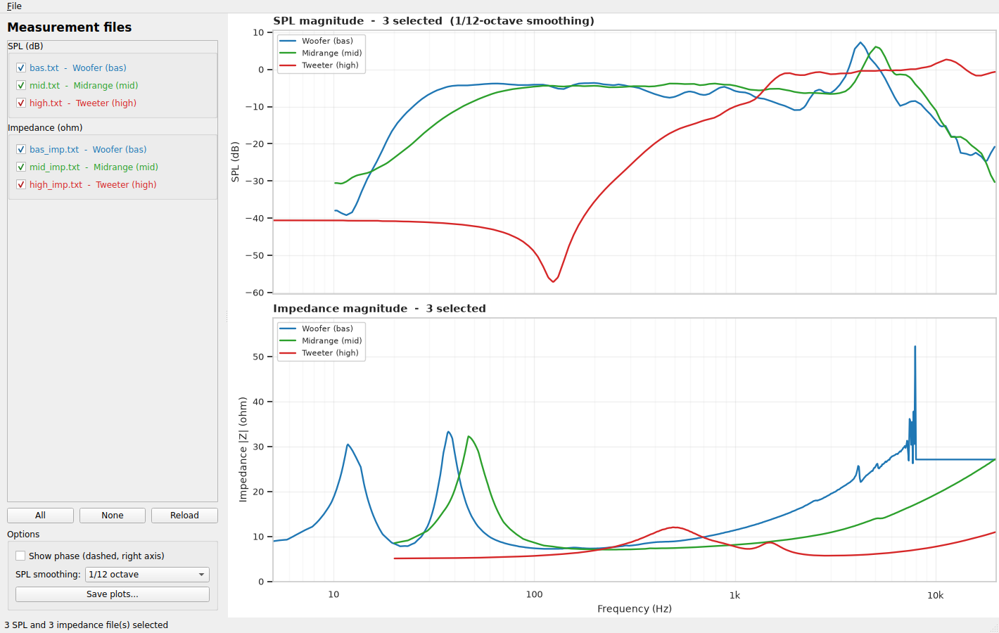

# Speaker measurement analysis

`analyze_speakers.py` reads the LSPCad text exports in `Mätdata/`, plots the
measurements and writes a summary report. `plot_speaker_gui.py` provides the
same measurements in an interactive window with per-file checkboxes.
`crossover_design.py` uses the data to propose a passive 3-way crossover and
writes an illustrated PDF.

## Setup

The repo does not ship a ready-made environment. Most scripts need the
third-party packages from `requirements.txt`:

```bash
python3 -m venv .venv
source .venv/bin/activate
pip install -r requirements.txt
```

The previous `.venv` was removed on purpose and no system pip is installed
in this workspace, so the venv has to be rebuilt on a machine that has pip.
The crossover schematic tooling needs nothing beyond the standard library:

```bash
python3 lspcad_schematics.py
```

## Run

```bash
source .venv/bin/activate
python analyze_speakers.py
```

Useful options:

```bash
# Write somewhere else
python analyze_speakers.py --output-dir analysis

# Use one analysis band for all drivers
python analyze_speakers.py --band 100 10000

# 1/24-octave smoothing, no interactive HTML, no Excel file
python analyze_speakers.py --smooth 24 --no-html --no-excel

# Show plots interactively (requires a desktop session)
python analyze_speakers.py --show
```

The data directory lookup is case-insensitive, so `--data-dir mätdata` also
finds `Mätdata`.

## Interactive viewer

For point-and-click exploration, start the GUI:

```bash
source .venv/bin/activate
python plot_speaker_gui.py
```



The window has:

- a checkbox for every measurement file, grouped into SPL and impedance
- an upper SPL plot and a lower impedance plot
- `All` / `None` buttons to select or clear every file
- an optional phase overlay (dashed, right-hand axis)
- selectable 1/3, 1/6, 1/12, 1/24 or 1/48-octave SPL smoothing
- `Save plots...` for PNG, PDF or SVG output

The GUI uses PySide6. On WSL it needs WSLg (or another working X/Wayland
display). If no display is available, use the static `analyze_speakers.py`
script instead.

## Crossover design

`crossover_design.py` analyses the three drivers and writes an illustrated
5-page PDF with measured plots, a passive crossover schematic, component
values and predicted performance:

```bash
source .venv/bin/activate
python crossover_design.py
```

The proposal uses second-order Linkwitz-Riley filters at about **306 Hz** and
**2.0 kHz**, Zobel impedance compensation on each driver and a small tweeter
L-pad. The midrange driver is connected with **reversed polarity**.

Generated files:

| File | Contents |
| --- | --- |
| `analysis/3_way_crossover_design.pdf` | Full design report, schematic and predicted response |
| `analysis/crossover_bom.csv` | Bill of materials |
| `analysis/crossover_simulation.csv` | Predicted filtered responses, summed response and system impedance |

The simulation uses the measured complex impedance and the measured SPL
phase. It is a starting point: the final acoustic result must be verified with
a microphone measurement, and the tweeter level may need adjustment.

## Input format

Each file is a whitespace-separated table with three columns:

```text
Freq    Mag    Phase
10.18   -37.7  -27.7
```

- `*_imp.txt` files are interpreted as impedance in ohm and degrees.
- All other `.txt` files are interpreted as SPL in dB and degrees.
- The driver name is the filename without the suffix, e.g. `bas_imp.txt` is
  the impedance of driver `bas`.

## Output

Everything is written to `analysis/` by default:

| File | Contents |
| --- | --- |
| `01_spl_magnitude.png` | SPL comparison, smoothed |
| `02_spl_phase.png` | SPL phase comparison |
| `03_impedance_magnitude.png` | Impedance comparison with Fs markers |
| `04_impedance_phase.png` | Impedance phase comparison |
| `05_spl_normalized.png` | SPL normalised to each driver's passband |
| `driver_*.png` | 2x2 overview per driver |
| `report.md` | Markdown report with tables and plots |
| `interactive_measurements.html` | Interactive Plotly report |
| `summary.csv` / `summary.xlsx` | All analysis results |
| `third_octave_levels.csv` | Average SPL per third-octave band |
| `measurements_combined.csv` | All parsed measurements in one table |

## Analysis notes

- The default analysis bands are driver-specific: woofer 30-1000 Hz,
  midrange 100-5000 Hz, tweeter 2000-20000 Hz. This avoids treating a
  tweeter's stopband as its passband. Override with `--band LOW HIGH`.
- The -3 dB / -6 dB limits are relative to the median level in the analysis
  band. Narrow notches are merged so a small dip does not split the passband.
- `Fs` is the largest impedance peak below `--fs-max` (default 2000 Hz).
- `Re` is the minimum measured impedance magnitude.
- `Qms`, `Qes`, `Qts` and `Le` are rough estimates from the impedance curve.
  They are only meaningful for free-air measurements; a driver measured in a
  box shows the box-loaded resonance instead.
- SPL levels are used exactly as exported. If the measurement was not
  calibrated, they are relative levels rather than absolute dB SPL.
# mySpeaker_gen1
