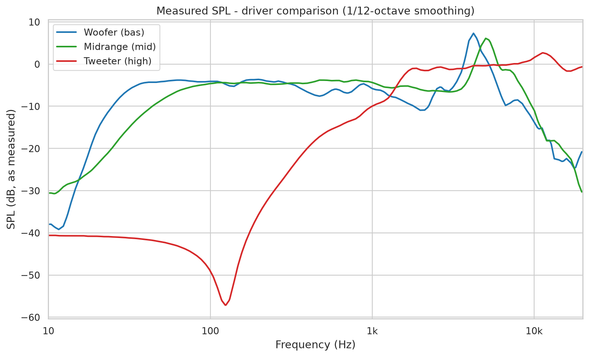
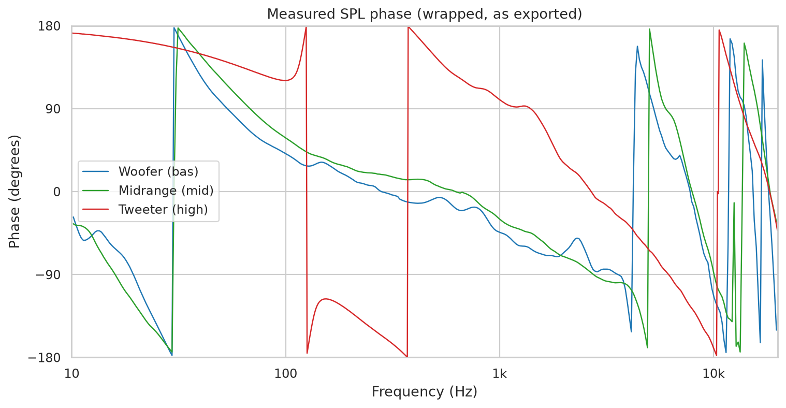
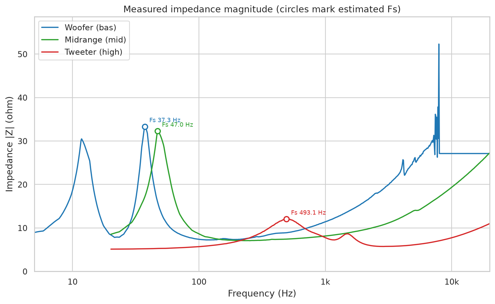
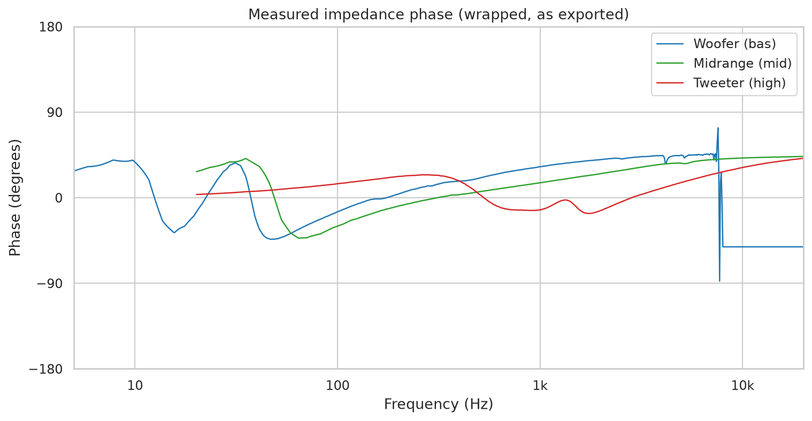
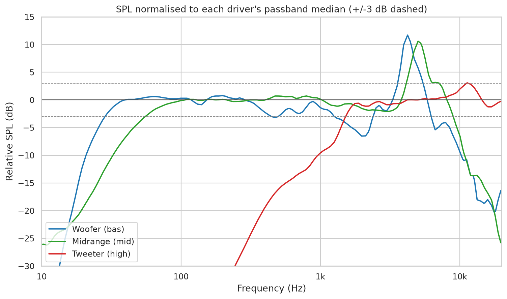
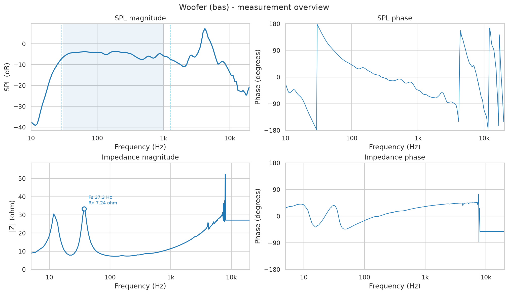
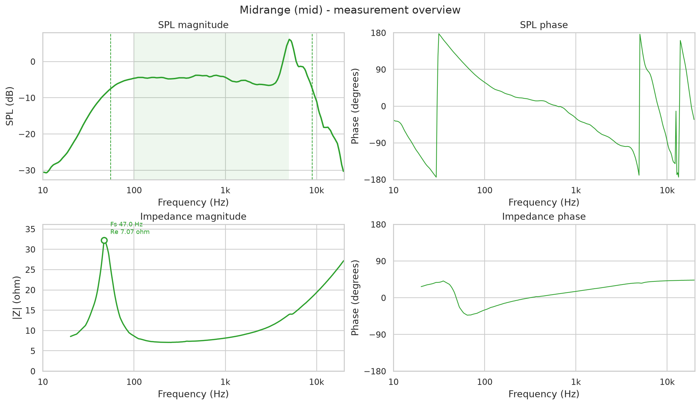
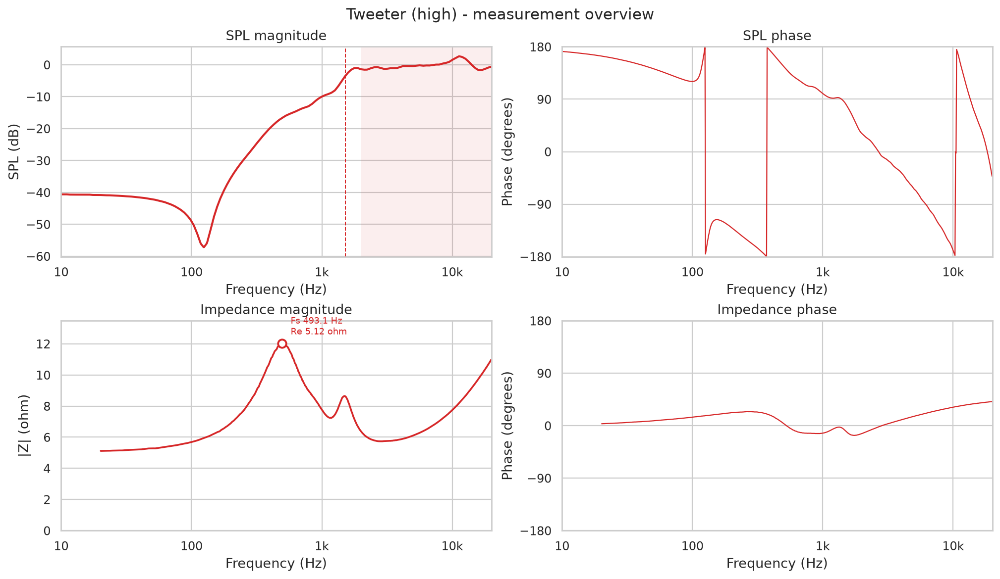

# Loudspeaker driver measurement analysis

Generated: 2026-11-06 18:22:18

- Data directory: `Mätdata`
- Analysis band override: per-driver defaults
- Smoothing: 1/12-octave smoothing

## Measurement files

| driver   | label          | spl_file   | impedance_file   |   spl_points |   imp_points |
|:---------|:---------------|:-----------|:-----------------|-------------:|-------------:|
| bas      | Woofer (bas)   | bas.txt    | bas_imp.txt      |          350 |          900 |
| mid      | Midrange (mid) | mid.txt    | mid_imp.txt      |          350 |          749 |
| high     | Tweeter (high) | high.txt   | high_imp.txt     |          900 |          749 |

## SPL summary

| driver   |   band_low_hz |   band_high_hz |   spl_band_mean_db |   spl_band_std_db |   spl_band_min_db |   spl_band_max_db |   f3_low_hz |   f3_high_hz |   f6_low_hz |   f6_high_hz |
|:---------|--------------:|---------------:|-------------------:|------------------:|------------------:|------------------:|------------:|-------------:|------------:|-------------:|
| bas      |            30 |           1000 |              -4.92 |              1.12 |              -7.6 |              -3.6 |       28.53 |      1259.41 |       24.42 |      1880.48 |
| mid      |           100 |           5000 |              -4.48 |              1.85 |              -6.6 |               5.8 |       55.43 |      8970.21 |       42.26 |      9851.68 |
| high     |          2000 |          20000 |              -0.24 |              1.12 |              -1.8 |               2.8 |     1518.63 |         -    |     1350.75 |         -    |

## Impedance summary

| driver   |   re_ohm |   fs_hz |   z_fs_ohm |   z_min_ohm |   z_max_ohm |   z_max_freq_hz |   z_1k_ohm |   qms |   qes |   qts |   le_mh |
|:---------|---------:|--------:|-----------:|------------:|------------:|----------------:|-----------:|------:|------:|------:|--------:|
| bas      |     7.24 |   37.31 |      33.31 |        7.24 |       52.3  |         7909.87 |      11.4  |  4.33 |  1.2  |  0.94 |    0.29 |
| mid      |     7.07 |   46.98 |      32.28 |        7.07 |       32.28 |           46.98 |       8.14 |  2.78 |  0.78 |  0.61 |    0.25 |
| high     |     5.12 |  493.13 |      12.04 |        5.12 |       12.04 |          493.13 |       7.77 |  0.79 |  0.58 |  0.34 |    0.09 |

## Notes

- SPL values are plotted exactly as exported. If the measurement was not calibrated, the levels are relative rather than absolute dB SPL.
- The -3 dB / -6 dB limits are relative to the median level in each driver's analysis band. The widest contiguous region above the threshold is used, and narrow notches are merged. A missing upper limit means the response stays within the threshold beyond the measured range.
- Fs is the largest impedance peak below the `--fs-max` limit (default 2000 Hz). Additional low-frequency peaks may be box or measurement artefacts.
- Fs, Re and the Q values are rough estimates from the impedance curve. They are only meaningful for free-air measurements; a driver measured in a box shows the box-loaded resonance.
- `Re` is taken as the minimum impedance magnitude in the measured range. `Le` is a rough estimate from the 10-20 kHz region.

## Plots

### SPL magnitude - all drivers

### SPL phase - all drivers

### Impedance magnitude - all drivers

### Impedance phase - all drivers

### Normalised SPL

### Woofer (bas) - overview

### Midrange (mid) - overview

### Tweeter (high) - overview

## Interactive report

[Open the interactive Plotly report](interactive_measurements.html)
